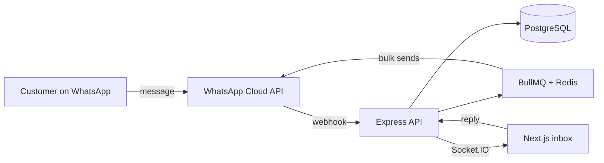

<h1 align="center">Gaurav Rai</h1>

  Full-stack developer building web apps for real businesses — CRMs, AI tools and e-commerce.

  <a href="https://gauravrai.vercel.app">Portfolio</a>&nbsp;&nbsp;·&nbsp;&nbsp;
  <a href="https://www.linkedin.com/in/gauravrai3133/">LinkedIn</a>&nbsp;&nbsp;·&nbsp;&nbsp;
  <a href="mailto:gauravrai3133@gmail.com">Email</a>&nbsp;&nbsp;·&nbsp;&nbsp;
  <a href="https://www.instagram.com/the_gaurav_rai">Instagram</a>

 

### About

I'm a full-stack developer who mostly works with **Next.js, TypeScript and Node.js**. Most of what I build ends up in front of actual users: a WhatsApp CRM that sales teams use every day, an email platform that writes campaigns with Gemini, and a gym app that runs on both web and phone.

I care about the parts people don't see — job queues, real-time updates, clean database schemas — as much as the UI.

Right now I'm learning more **React Native** and getting deeper into **AI integrations**. I'm open to freelance work and full-time roles.

 

### Tech

  

Also: Socket.IO · BullMQ · Expo · shadcn/ui · Framer Motion · Three.js · NextAuth · Google Gemini API

 

### Projects

| Project | Description |
| :-- | :-- |
| **[ERP-WA](https://github.com/gauravera/erpwa-1)** | WhatsApp Business CRM with a shared team inbox, lead pipeline, template messaging and bulk sends. Next.js · Express · PostgreSQL · Prisma · BullMQ · Socket.IO |
| **[AI Email Platform](https://github.com/gauravera/email-main)** · [live](https://email-gpserp.vercel.app) | Multi-brand email campaigns with an inbox, analytics and AI-written emails. Next.js · NextAuth · Prisma · Gemini · AWS S3 |
| **[Gym Suite](https://github.com/gauravera/gym)** · [live](https://gym-phi-ashy.vercel.app) | Gym management across web and mobile, with passkey login and live updates. Next.js · Expo · Express · PostgreSQL · WebAuthn |
| **[E-Card Magic](https://github.com/gauravera/wishes)** · [live](https://wishes-rose-three.vercel.app) | Interactive greeting cards with recorded voice notes, secret unlock questions and QR sharing. Next.js · React 19 · Three.js · MongoDB |
| **[Temple Fund Management](https://github.com/gauravera/Temple-Fund-Management-Using-Blockchain)** | Records temple donations on-chain so every rupee can be traced. Solidity · Polygon · MetaMask · Next.js · MongoDB |
| **[SitaraHub Store](https://github.com/gauravera/sitarahub)** | E-commerce store with filters, wishlist and a checkout that autofills address from a PIN code. React · Vite · Tailwind |

More projects

 

| Project | Description |
| :-- | :-- |
| [i-support-wangchuk](https://github.com/gauravera/i-support-wangchuk) | Civic transparency dashboard with a live incident feed and pledge form |
| [indoglobaltradefair](https://github.com/gauravera/indoglobaltradefair) | Website for the Indo Global Trade Fair |
| [sitarahubtimes](https://github.com/gauravera/sitarahubtimes) | News and media portal |
| [wedding-project](https://github.com/gauravera/wedding-project) | Animated wedding invitation site |

How ERP-WA works

 

 

### Activity

  <picture>
    <source media="(prefers-color-scheme: dark)" srcset="https://github-profile-summary-cards.vercel.app/api/cards/stats?username=gauravera&theme=github_dark" />
    
  </picture>
  <picture>
    <source media="(prefers-color-scheme: dark)" srcset="https://github-profile-summary-cards.vercel.app/api/cards/most-commit-language?username=gauravera&theme=github_dark" />
    
  </picture>

  <picture>
    <source media="(prefers-color-scheme: dark)" srcset="https://raw.githubusercontent.com/gauravera/gauravera/output/github-snake-dark.svg" />
    
  </picture>

Contributions in 3D

 

  <picture>
    <source media="(prefers-color-scheme: dark)" srcset="https://raw.githubusercontent.com/gauravera/gauravera/main/profile-3d-contrib/profile-night-view.svg" />
    
  </picture>

 

### Get in touch

Have a project in mind or want to work together? Email me at **[gauravrai3133@gmail.com](mailto:gauravrai3133@gmail.com)** or message me on [LinkedIn](https://www.linkedin.com/in/gauravrai3133/).
